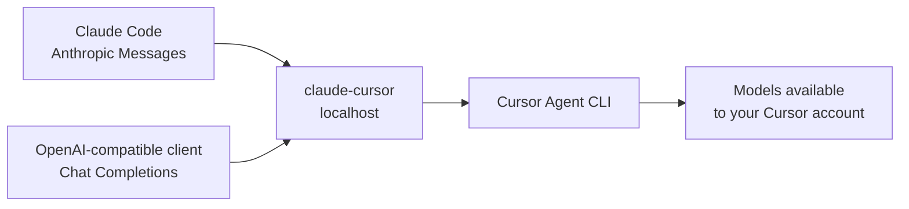

# claude-cursor

[](https://github.com/tzachbon/claude-cursor/actions/workflows/ci.yml)
[](LICENSE)

A local compatibility bridge that lets Claude Code and OpenAI-compatible
clients use models available through the Cursor Agent CLI.

> [!IMPORTANT]
> This is an unofficial community project. It is not affiliated with, endorsed
> by, or supported by Anthropic or Cursor.


## Why

Claude Code speaks the Anthropic Messages API, while many other tools speak the
OpenAI Chat Completions API. Cursor Agent exposes a command-line interface
rather than either HTTP protocol. `claude-cursor` translates between them
locally:



## Features

- Anthropic-compatible `POST /v1/messages`
- OpenAI-compatible `POST /v1/chat/completions`
- streaming responses with server-sent events
- model discovery through the installed Cursor Agent CLI
- conversation resumption backed by a local SQLite mapping
- loopback-only default binding
- prompt-free operational logs by default
- no private Cursor endpoints or desktop-token extraction

## Quick start

### Requirements

- Node.js 22.18 or newer
- [Cursor Agent CLI](https://docs.cursor.com/en/cli/installation), installed and
  authenticated
- a Cursor plan or API key that permits CLI model use

### Install and run

```sh
git clone https://github.com/tzachbon/claude-cursor.git
cd claude-cursor
npm ci
cp .env.example .env
npm start
```

The server listens on `http://127.0.0.1:8080`.

```sh
curl http://127.0.0.1:8080/health
```

## Use with Claude Code

Claude Code supports a custom Anthropic API base URL. The bridge does not
validate the downstream token, but Claude Code expects a non-empty value.

```sh
ANTHROPIC_BASE_URL=http://127.0.0.1:8080 \
ANTHROPIC_AUTH_TOKEN=local-cursor-bridge \
claude
```

## Use with an OpenAI-compatible client

```sh
curl http://127.0.0.1:8080/v1/chat/completions \
  -H 'content-type: application/json' \
  -d '{
    "model": "auto",
    "stream": false,
    "messages": [
      {"role": "user", "content": "Reply with exactly: bridge-ok"}
    ]
  }'
```

## API surface

| Method | Path | Purpose |
| --- | --- | --- |
| `GET` | `/` | service metadata |
| `GET` | `/health` | health and upstream mode |
| `GET` | `/v1/models` | Cursor model discovery |
| `GET` | `/v1/metrics` | recent in-memory request timings |
| `POST` | `/v1/messages` | Anthropic Messages compatibility |
| `POST` | `/v1/chat/completions` | OpenAI Chat Completions compatibility |

## Security model

Keep the default `HOST=127.0.0.1`. The server has no downstream
authentication or TLS and is not designed for direct network exposure.

Cursor Agent runs non-interactively with `--force` and `--trust` inside a
dedicated bridge workspace. The workspace reduces accidental project context;
it is not an operating-system sandbox or a proven no-tools boundary.

See [SECURITY.md](SECURITY.md) before deploying or modifying the trust model.

## Documentation

- [Getting started and configuration](docs/getting-started.md)
- [Architecture](docs/architecture.md)
- [API compatibility and limitations](docs/compatibility.md)
- [Claude Code hook example](examples/claude-code/README.md)

## Development

```sh
npm ci
npm run check
```

`npm run check` runs strict TypeScript checking, the proxy test suite, and the
Claude Code hook test.

Contributions are welcome. Read [CONTRIBUTING.md](CONTRIBUTING.md) before
opening an issue or pull request.

## License

[MIT](LICENSE)
