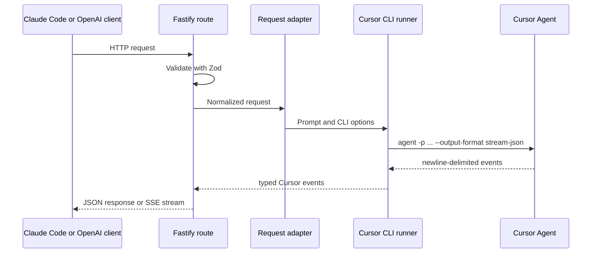

# Architecture

`claude-cursor` is a protocol adapter around the public Cursor Agent CLI. It
does not implement a model server or call Cursor's private transport.

## Request flow

## Modules

| Area | Responsibility |
| --- | --- |
| `src/routes/` | HTTP validation, streaming headers, error mapping |
| `src/adapters/` | Anthropic/OpenAI request and response translation |
| `src/upstream/` | Cursor Agent process lifecycle and event parsing |
| `src/utils/session-store.ts` | conversation key to Cursor chat ID mapping |
| `src/utils/request-metrics.ts` | bounded in-memory latency observations |
| `src/types/` | API schemas and event types |

## Conversation continuity

HTTP requests are stateless, but Cursor chats are not. For Anthropic requests,
the bridge derives a stable conversation key using this precedence:

1. `metadata.session_id`
2. `metadata.user_id`
3. a SHA-256 digest of the system prompt and first user message

The key maps to a Cursor chat ID in SQLite. A later request uses
`agent --resume <chat-id>`. The database contains identifiers and timestamps,
not a copy of the conversation.

## Streaming

Cursor Agent emits newline-delimited JSON. The runner distinguishes incremental
text events from full-text snapshots so repeated tokens remain valid while
consolidated duplicate messages are removed. Response adapters convert the
result into Anthropic or OpenAI server-sent events.

## Trust boundary

The HTTP boundary is local and unauthenticated. The process boundary starts a
trusted Cursor Agent in a dedicated workspace. The workspace is context
isolation, not process isolation: Agent may still have shell and filesystem
capabilities available to its process.

The project deliberately excludes private Cursor protocols, access-token
extraction, checksum synthesis, and automatic fallback between unrelated
upstream contracts.
